<p align="center">
  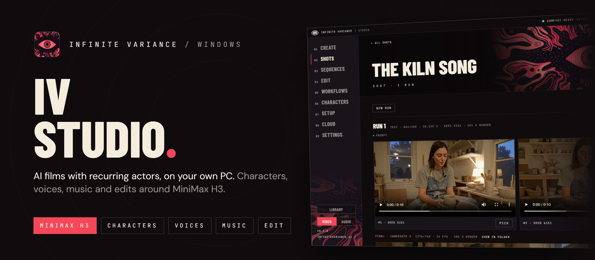
</p>

<p align="center">
  <a href="https://github.com/hollisorg/iv-studio/releases/latest/download/IV-Studio-Setup.exe"><b>Download for Windows</b></a>
  &nbsp;·&nbsp;
  <a href="#what-you-need">What you need</a>
  &nbsp;·&nbsp;
  <a href="https://github.com/hollisorg/iv-studio/releases/latest">Release notes</a>
  &nbsp;·&nbsp;
  <a href="https://infinitevariance.ai">Infinite Variance</a>
</p>

# IV Studio

A free Infinite Variance desktop app for making short films with
[MiniMax H3](https://huggingface.co/MiniMaxAI/MiniMax-H3) on your own PC. Give a recurring actor a face
and a voice, write a shot, hunt a few quick previews and finish the best one at full size. Then add
music, cut it all together and export. IV Studio drives your own
[ComfyUI](https://github.com/comfyanonymous/ComfyUI); nothing leaves your machine unless you choose the
cloud.

<p align="center">
  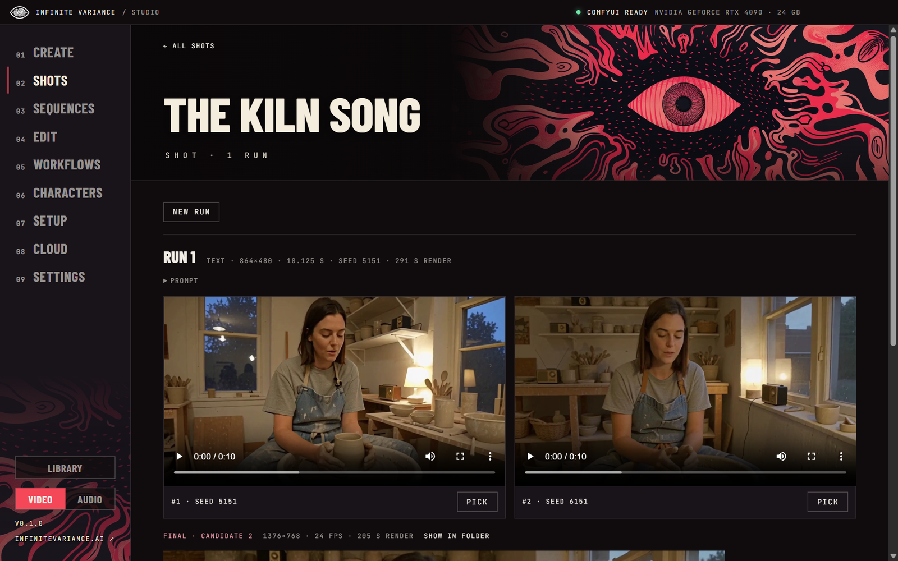
</p>

## What it does

- **Shots.** Write a shot (or type the idea in plain words and let **Write it for me** write the H3
  prompt), hunt one to three quick previews, pick one and finish it at 1 to 2 MP with DLSS, an RTX 2×
  upscale and frame generation. Four modes: text, reference pictures, video and audio, first and last
  frame, and continuing a video.
- **LoRAs.** Browse Civitai's MiniMax H3 LoRAs as cards whose clips play on hover, and download one
  straight into ComfyUI. Your own LoRAs show as pictures too, and Create's LoRA tray adds them to a shot
  with a strength slider.
- **Characters.** Recurring actors as trained H3 LoRAs with a trigger word. Use the ready-made Tess and
  Theo, add a LoRA you have, or design, clip and train your own on your Modal account.
- **Voices.** Give each character a voice: design one from a description, or save one from a recording.
  Type a line and **Speak it**: the character says it on screen, lip-synced. Runs on your PC with
  VoxCPM2 and Whisper.
- **Music.** Songs with sung lyrics, or instrumentals, from a style and lyrics: MiniMax Music 3 for full
  songs up to five minutes, ACE-Step 1.5 for a draft in seconds. Put a song under an edit, or have a
  character sing it.
- **Sequences.** Several shots that play as one continuous video, rendered as one take or shot by shot,
  with retakes of any stretch.
- **Edit.** A Premiere-style editor with a full-screen workspace: project bin, source and program
  monitors, as many video and audio tracks as you need, filmstrips and waveforms, markers, J/K/L,
  insert and overwrite, razor, ripple and rolling trims, and MP4 export at 1080p, 4K, vertical or square.
- **Workflows.** **Sizzle** turns a website into a promo film: your agent storyboards it from the real
  site, then H3 shots, pictures, music and the site's own screens are cut together on the beat. **Replace** swaps a
  person or an object in a video while the camera, motion and sound stay. **Shinobi** lets an agent cut a
  whole edit in code.
- **Library.** Every shot, sequence, export, song and spoken line in one place, ready to drop onto an
  edit or into a shot.
- **Agents.** A local MCP server with 101 tools gives Claude Code or any MCP client nearly everything a
  person can do in the window.

<table>
  <tr>
    <td width="50%">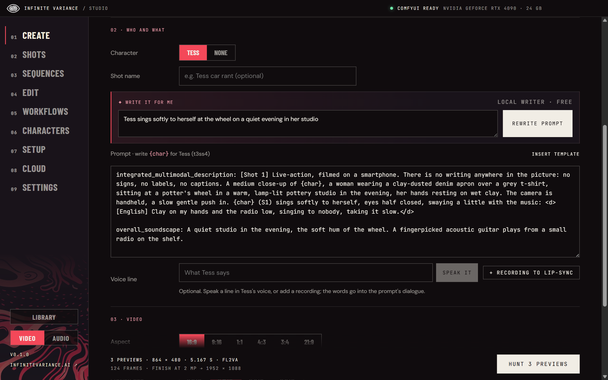</td>
    <td width="50%">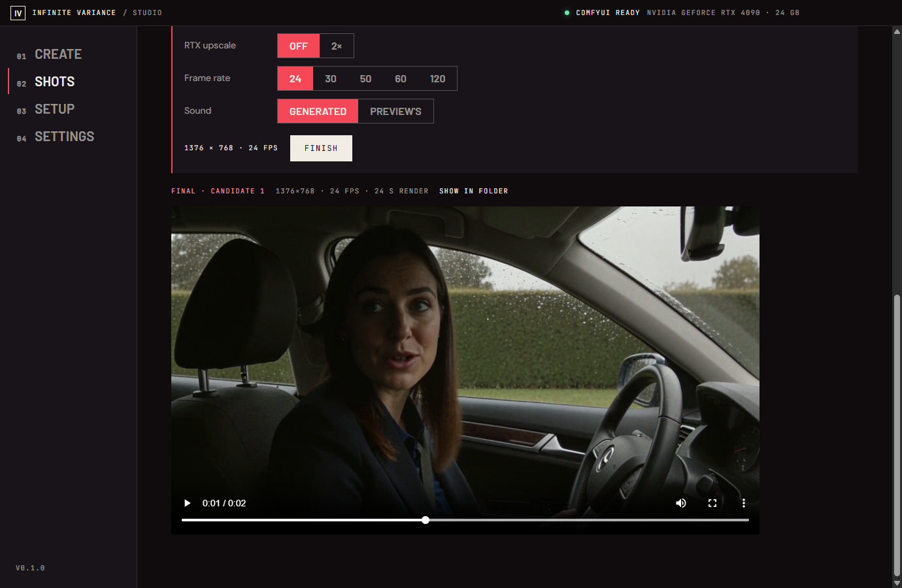</td>
  </tr>
  <tr>
    <td align="center"><sub>Write the shot, or describe it and let it be written</sub></td>
    <td align="center"><sub>Finish the take you like at full size</sub></td>
  </tr>
  <tr>
    <td width="50%">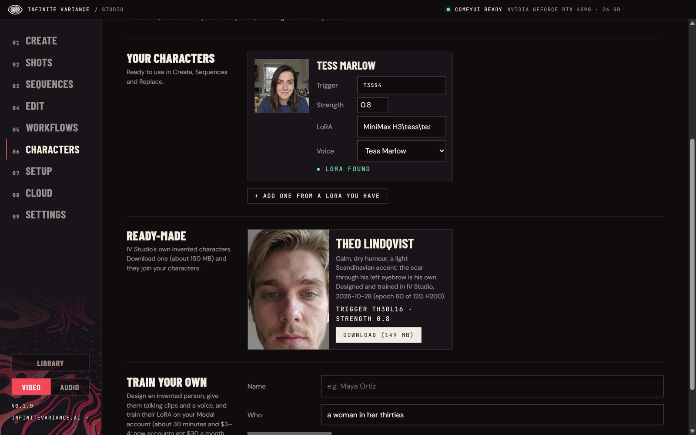</td>
    <td width="50%">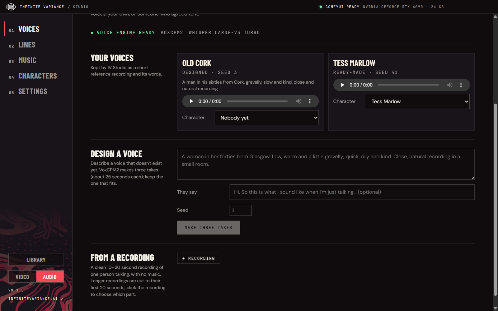</td>
  </tr>
  <tr>
    <td align="center"><sub>Recurring characters, ready-made or trained</sub></td>
    <td align="center"><sub>A voice for every character</sub></td>
  </tr>
  <tr>
    <td width="50%">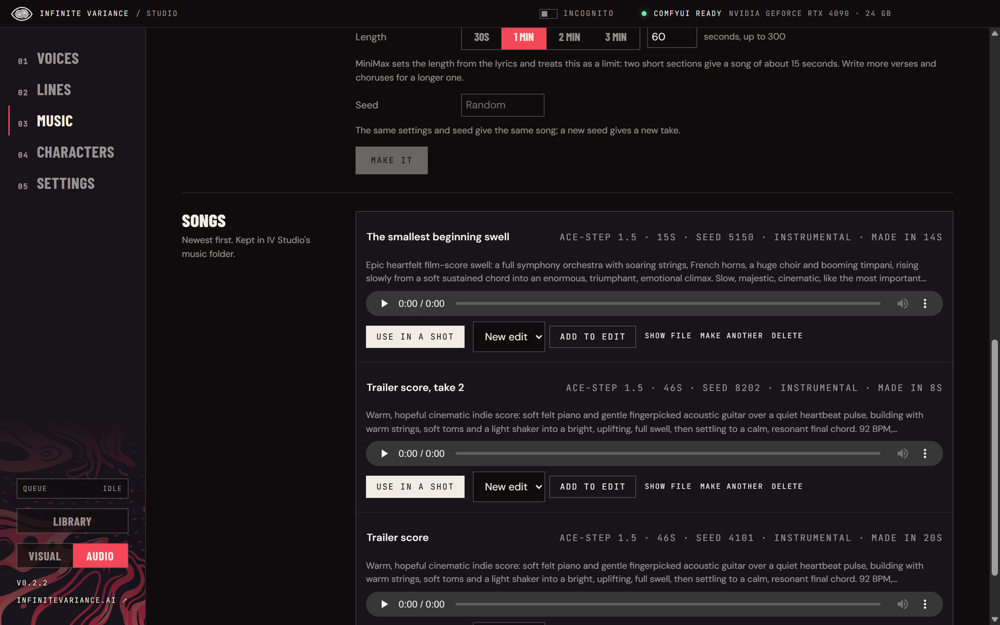</td>
    <td width="50%">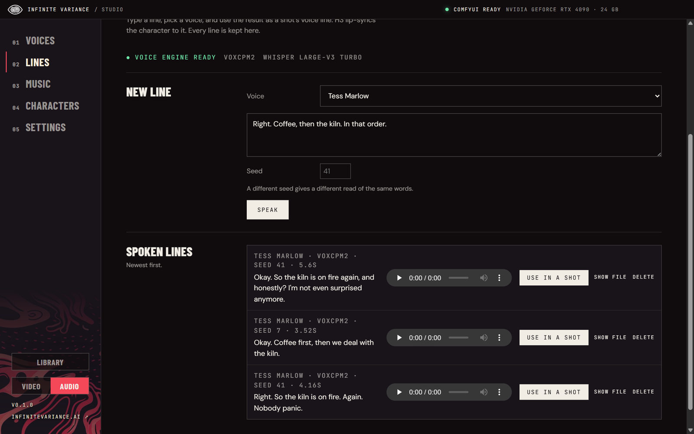</td>
  </tr>
  <tr>
    <td align="center"><sub>Songs and scores, made on your PC</sub></td>
    <td align="center"><sub>Say it in their voice</sub></td>
  </tr>
  <tr>
    <td width="50%">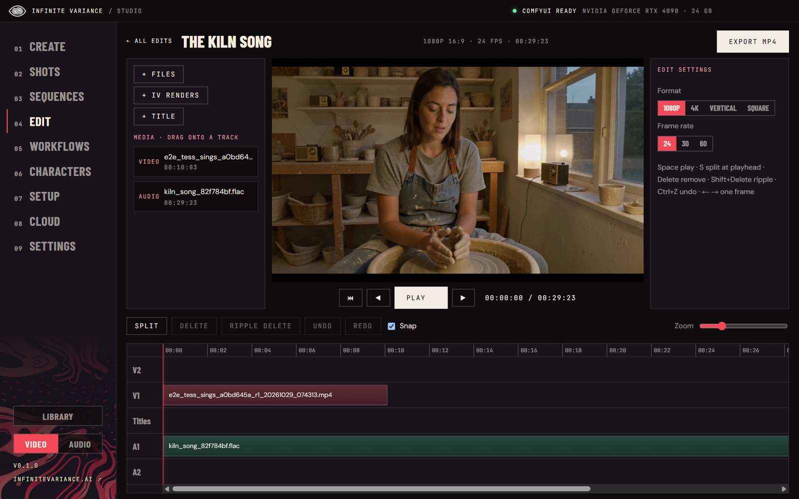</td>
    <td width="50%">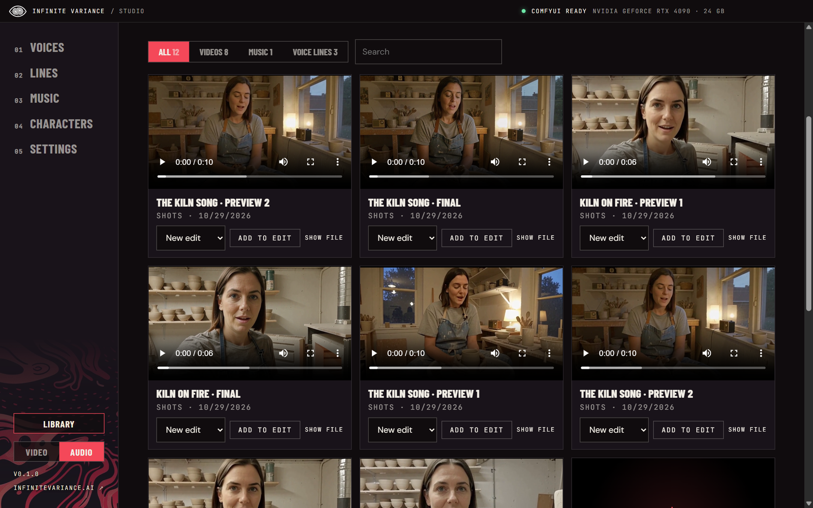</td>
  </tr>
  <tr>
    <td align="center"><sub>A Premiere-style editor, full screen, with your agent cutting alongside</sub></td>
    <td align="center"><sub>Everything you've made, in one place</sub></td>
  </tr>
</table>

## What you need

- **Windows 10 or 11** (64-bit).
- **An NVIDIA GPU.** 24 GB of VRAM is what IV Studio is tested on (an RTX 4090); 16 GB works with smaller
  previews and finals. 64 GB of system RAM is recommended.
- **[ComfyUI](https://github.com/comfyanonymous/ComfyUI)**, version 0.33 or newer, running on the same PC.
  IV Studio talks to it at `http://127.0.0.1:8188` (change it in Settings).
- **Disk space.** About 60 GB for the H3 models. Music adds about 14 GB (MiniMax Music 3) or 10 GB
  (ACE-Step); voices add about 12 GB. Each is a one-click download inside the app.
- **Optional:** [Ollama](https://ollama.com) for the free local prompt writer, and a
  [Modal](https://modal.com) account for cloud rendering and character training.

## Install

1. [Download `IV-Studio-Setup.exe`](https://github.com/hollisorg/iv-studio/releases/latest/download/IV-Studio-Setup.exe)
   (about 180 MB).
2. Run it. The installer isn't code-signed yet, so Windows may show **"Windows protected your PC"**.
   Click **More info → Run anyway**. It installs for your user only; no admin rights needed.
3. Start ComfyUI, then IV Studio. **Settings → Setup** checks ComfyUI, your GPU, the node packs and every
   model, downloads missing models straight into ComfyUI's models folder (each checked against the
   SHA-256 its host publishes) and links any node pack you still need.
4. For voices, open **Audio → Voices** and press **Set up voices** once. For music, open
   **Audio → Music** and download the engine you want.

Your projects, voices and songs are kept in `%APPDATA%\IV Studio`; renders are saved in ComfyUI's
output folder under `H3\`.

**Updates.** From 0.2.1 on, IV Studio checks for a new version when it starts and every six hours, and
downloads it in the background. Click **↻ Update to …** at the bottom of the sidebar (or **Restart to
update** in Settings → Updates) to install it and reopen; otherwise it installs the next time you quit.
It waits while an edit is exporting or models are downloading. Coming from 0.2.0 or older, install 0.2.1
by hand once.

<p align="center">
  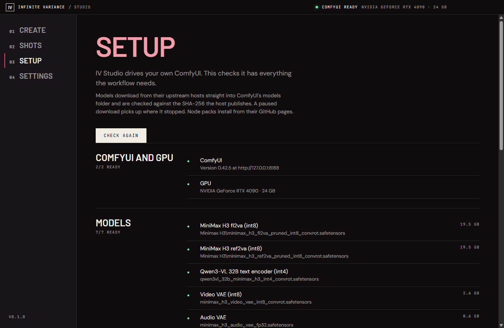
</p>

## How a shot works

1. **Create.** Pick a mode, a character and write the shot.
   - **Text:** just the prompt.
   - **References:** pictures, videos or audio guide the shot (`<Picture 1>`, `<Video 1>`, `<Audio 1>`).
     Click a reference to crop or trim it; videos snap to H3's lengths.
   - **First / last frame:** the clip opens on a picture and can end on a second one.
   - **Continue a video:** carries a clip on from its last frames.

   Set the aspect, length, preview size and how many previews to hunt (1 to 3). Optional extras: a voice
   line to lip-sync, RefMods, extra LoRAs and the step count.
2. **Hunt.** IV Studio queues the previews on ComfyUI and shows them as they finish.
3. **Pick and finish.** Choose a preview and set the final size (1, 1.5 or 2 MP), RTX 2× upscale, frame
   generation (30/50/60/120 fps) and the sound source. The finish starts from the preview's own latent,
   so the motion stays the same.
4. **Shots.** Every shot keeps its runs, previews and finals. **Show in folder** opens the file.

### Write it for me

You don't need to know H3's prompt format. Type the idea in plain words, for example "Tess in a parked
car at night admits she kept the letter", and press **Write my prompt**. You get a finished H3 prompt
back to edit, keep or undo. It always uses your mode, length, aspect, character and media. Choose the
writer under **Settings → Prompt writer**:

- **Local (free):** a model in Ollama on your PC with IV Studio's H3 rule sheet. The recommended model is
  `huihui_ai/qwen3-vl-abliterated:8b-instruct` (about 6 GB, one click to install), huihui-ai's uncensored
  copy of Qwen3-VL 8B Instruct (Apache-2.0), so it doesn't refuse mature ideas. Any other Ollama model works
  too, including the original `qwen3-vl:8b-instruct`. It can look at your pictures, and while ComfyUI is
  rendering it runs on the CPU, so it never takes H3's VRAM.
- **MiniMax Context IR:** MiniMax's own prompt rewriter through ComfyUI, paid through your Comfy.org
  account (about $0.02 to $0.11 a prompt). Your API key is stored encrypted on your PC.

## Images

**Create** switches between **Video** (a shot) and **Image** at the top. Image makes pictures on your PC with
the image models you have in ComfyUI:

| Family | Generate | Edit | Licence |
|---|---|---|---|
| Flux.2 Klein 9B | ✓ | ✓ several reference pictures | FLUX Non-Commercial (9B) |
| Flux 3 Klein | ✓ | ✓ | FLUX Kommunity |
| Krea 2 | ✓ | ✓ with the Krea 2 Identity Edit LoRA and the comfyui-krea2edit nodes | see Krea 2's model page |
| Moss | ✓ | needs a newer ComfyUI | Apache-2.0 |
| Qwen Image 2.1 | ✓ | ✓ up to three references | Apache-2.0 |
| Z-Image Turbo | ✓ | ✗ | Apache-2.0 |

Pick **Generate** or **Edit**; Edit lists only the families that can. Pick a family and one of its
checkpoints (your fine-tunes are there too), add that family's LoRAs from the same picker as Video's, then
the size, how many (1 to 4) and a seed. Each graph follows ComfyUI's official template for its model.

Finished pictures appear under the form and in the **Library**. Open one to **Use in a shot** (it becomes the
shot's first frame), **Edit this**, **Add to edit**, **Make more like this** or **Show file**. Agents use
`list_image_models` and `make_image`.

## Characters

A character is a trained MiniMax H3 LoRA plus its trigger word; write `{char}` in the prompt where the
character goes. On the **Characters** page:

- **Your characters:** each with its picture, trigger, strength, LoRA (checked against ComfyUI) and voice.
- **Ready-made:** IV Studio's own invented characters, Tess Marlow and Theo Lindqvist. Download one and
  its LoRA (about 150 MB, from this repo's `characters-v1` release, checked against its SHA-256) goes into
  ComfyUI, and their bundled voice comes with them.
- **Train your own,** the method that made Tess:
  1. **Design:** describe the face; Z-Image Turbo renders four candidates on your PC. The one you pick is
     rendered in eight scenes on the same seed. Or add your own pictures, only of an invented person or
     someone who agreed.
  2. **Clips:** H3 renders talking clips from the stills and the character's voice, or you add your own.
     Everything is fitted to Fizgig's rules (24 fps, 17n+5 frames, 32 kHz stereo).
  3. **Train:** Fizgig on your own Modal account, with the minutes and dollars shown first. Theo took
     56 minutes and about $4.10 on an H200.
  4. **Pick:** checkpoints are rendered side by side on one seed; the one you choose becomes a character,
     keeping the voice its clips were made with.

  **Likeness:** with InsightFace's face models (a one-time 289 MB download; non-commercial licence), IV
  Studio scores every still and clip against the picked face and can keep the closest of each scene.

## LoRAs

**LoRAs** (on the Visual side) changes how H3 looks and moves: styles, motion, camera, speed.

- **Discover** searches [Civitai](https://civitai.com)'s MiniMax H3 LoRAs: cards with clips that play on
  hover, filters (style, concept, cinematic, motion, camera, effect, speed, tool) and sorting. Open one for
  its example clips, versions, trigger words, licence (whether commercial use is allowed) and the maker's
  notes, then **Download**: the file goes into ComfyUI's `loras\Civitai\<model>\` folder, checked against the
  SHA-256 Civitai publishes. Downloading needs your own free Civitai API key (**Settings → Civitai**; it's
  stored encrypted on your PC). Searching doesn't.
- **Yours** shows the LoRAs already in ComfyUI, grouped by folder, H3 ones first. **Find on Civitai** looks
  each one up by its file's SHA-256 for its name, trigger words and a preview. Star your favourites.
- **Create's LoRA tray** shows the LoRAs in a shot as pictures with a strength slider; **+ Add LoRA** opens
  the same browser. A LoRA's trigger words go into the prompt when you add it.
- **Mature LoRAs** are off. **Settings → Civitai → Show mature LoRAs (18+)** switches to civitai.red, with
  previews blurred until clicked; a second box, **Show mature previews without the blur**, drops the blur.
  LoRAs of real people and anything involving minors are never shown, in either mode.

## Voices

**Audio → Voices** keeps a voice for every character, and **Audio → Lines** says anything in any of them.

- **Design a voice** from a description ("a woman in her forties from Glasgow, low, warm and a little
  gravelly"): three takes to choose from.
- **From a recording:** a clean 10 to 20 seconds of one person talking. Only your own voice, an invented
  one, or someone who agreed, and IV Studio asks you to confirm.
- **Speak it:** in **Create**, a character with a voice gets a **Speak it** box. Type the line; it becomes
  the shot's voice line, and the same words go into the prompt so H3 lip-syncs them.
- **Lines** keeps every line you've spoken, ready to use in a shot or drop on an edit. A new seed gives a
  new read of the same words.

The speaking runs on your PC in IV Studio's own Python environment (set up once, about 12 GB):
[VoxCPM2](https://huggingface.co/openbmb/VoxCPM2) (OpenBMB, Apache-2.0) designs, clones and speaks, and
[Whisper large-v3 turbo](https://huggingface.co/openai/whisper-large-v3-turbo) (OpenAI, MIT) reads the
words in a recording. A line takes about 4 seconds once the model is loaded. The voice engine is stopped
before every render, so it never shares the GPU with H3.

## Music

**Audio → Music** makes songs and instrumentals on your PC through ComfyUI's own nodes:

- **MiniMax Music 3:** full songs up to five minutes with the clearest sung words of the open models.
  Describe the style and write lyrics with `[Verse]`, `[Chorus]` and other section tags; the song's length
  follows the lyrics. About a minute or two per song on an RTX 4090.
- **ACE-Step 1.5 Turbo:** a song in seconds, with tempo, key, time signature and language. Best for drafts,
  background music and instrumentals.

Every song is kept in IV Studio's music folder. **Add to edit** puts it on A1 of a new or existing edit;
**Use in a shot** makes it the voice line, so a character sings it (trim it to the shot first).

## Sequences

Several shots that play as one continuous video.

- **One take:** every shot renders together in one seamless take through
  [H3 Multishot](https://github.com/jlucasmcrell/ComfyUI-H3-Multishot)'s sampler, so there are no cuts,
  colour shifts or breaks in the sound.
- **Shot by shot:** hunt and pick each shot in turn; each carries on from the end of the one before.
- **Retake:** mark a stretch of any version and redo the picture and sound, the picture only, or the sound
  only. Everything around it stays.
- **Render out:** optional colour smoothing across the joins, then DLSS with RTX 2× and frame generation.

Shots are 10 or 15 seconds, the lengths H3 Multishot is tested at.

## Edit

An editor laid out like Adobe Premiere for cutting shots, sequences, songs and lines together. **Full
screen** (or F11) hides IV Studio's sidebar and gives the whole screen to the edit; Esc brings it back.

- **Panels.** Project bin, Source monitor, Program monitor and Effect controls on top, the timeline below.
  Drag any border to resize; the layout is remembered.
- **Project bin.** Thumbnails, search, and Video, Pictures and Sound bins. Its Library tab holds every IV
  Studio render, song and line, one click from the edit.
- **Source monitor.** Click a bin item to open it, mark In (I) and Out (O), then press , to insert it at the
  playhead (everything after moves right) or . to overwrite. Or drag the picture onto a track.
- **Timeline.** As many video and audio tracks as you need (a higher V track plays over a lower one), plus
  titles. Each track can be targeted (click its name), hidden, locked, muted or soloed. Video clips show a
  filmstrip and their sound's waveform; sound clips show a waveform. Markers sit on the ruler.
- **Tools.** Select (V), Razor (C, click to cut), Ripple trim (B, the rest of the track follows) and Rolling
  edit (N, moves a cut between two clips). Each clip has fades and volume; titles have their own text,
  size, colour, position and box.
- **Export MP4** renders the timeline at 1080p, 4K, vertical or square, 24/30/60 fps, into
  `Videos\IV Studio\Edits`. Hidden tracks stay out of the picture and muted ones out of the sound.

Keys, as in Premiere: Space play · J K L shuttle (press again to go faster) · ← → one frame (Shift: one
second) · ↑ ↓ previous / next edit · I O mark · , insert · . overwrite · S split · Ctrl+K split every track ·
Q W ripple trim to the playhead · Delete, Shift+Delete ripple delete · M marker, Shift+M next marker ·
\ fit · = − zoom · Ctrl+Z / Ctrl+Y · F11 full screen, Esc back.

**With an agent.** Your agent edits the same timeline through IV Studio's MCP server. Its changes appear
at once with a strip saying what it did and a one-click Undo, and tracks you lock are off limits to it.

## Library

The **Library** button above the Visual | Audio switch opens everything you've made: shot finals and
previews, sequences, Replace runs, Edit exports, songs and spoken lines, newest first. Filter by type or
search, then add any of them to an edit or use a sound as a shot's voice line.

## Incognito

The **Incognito** switch in the title bar restarts IV Studio into a separate, private space, and the eye
closes. Shots, sequences, edits, songs, voices and lines, characters, trainings, Shinobi films, sizzles and
exports made there are kept apart (in `%APPDATA%\IV Studio\incognito`, exports in its `videos` folder) and
never show in the normal app; nothing normal shows there. Your characters and saved voices come along, and
settings, keys and models are shared. ComfyUI saves Incognito renders into its `output\IV Private` folder
(uploads into `input\IV Private`), and leaving Incognito clears them from ComfyUI's history. Switch back
the same way.

**Settings → Folders** picks where in ComfyUI's output folder renders save, one folder for normal renders
(straight into `output` unless you name one) and one for Incognito (`IV Private` unless you change it). They
can't be the same folder, and they always stay inside ComfyUI's folders.

Incognito keeps things out of IV Studio's normal views. It isn't encryption: the files are on your PC, in
the folders above, and LoRAs trained in Incognito land in ComfyUI's LoRAs folder like any other.

## Workflows

### Sizzle

Put in a web address and get a short promo film for it.

1. **Capture.** IV Studio opens the site in your PC's Edge or Chrome (hidden) and saves what people see: a
   screenshot of every screen down the page, the phone layout and the logo, plus the site's words, colours,
   fonts and pictures. Cookie banners are hidden, never accepted.
2. **Storyboard.** Your agent writes the scenes from the capture: the site's own screens, H3 shots,
   Z-Image pictures, titles from the site's copy, music and an optional voice-over. Nothing renders until you
   approve it.
3. **Pieces.** H3 shots (previewed, then finished at 1 MP), pictures, music and the voice-over are made on
   your PC: about 3-5 minutes per H3 shot.
4. **The film.** **Cut it for me** puts everything in a Shinobi project and cuts a first version: cuts on
   the music's beat, the site's screens with slow push-ins, two-tone titles in its colours, and an end card
   on the logo, the main button's words and the web address, ending where the music ends. It renders in
   about 2-3 minutes. Your agent can then refine it in Shinobi (the site's own fonts, pans, effects).

The Sizzle page shows the capture, the storyboard with each scene's piece, and the finished film, with a
message to paste into your agent. Agents use the `sizzle_*` tools.

### Replace

Swaps who or what is in a video while the camera, cuts, motion and soundtrack stay:

- **Person:** a picture (or one of your trained characters, with their LoRA) replaces the main person.
- **Several people:** one to four characters, each replacing someone you describe.
- **Object:** change something (hair, a jacket, a car), remove it, or put a new background behind the person.
- **Finish:** redraw small faces at close-up size, or soften H3's look.
- **Check the mask** first shows what will be redrawn, in about a minute.

It runs [OpenJutsu](https://github.com/D3voz/openjutsu)'s ComfyUI workflows (MIT, commit `47c3724`): SAM 3.1
tracks the people, Qwen3-VL describes the shots, and MiniMax H3 redraws the masked area.

### Shinobi

IV Studio's agent-driven editor. Where **Edit** is cut by hand, Shinobi lets an agent (or a one-click recipe
from 12 styles) author the whole edit in code: cuts on the beat, speed ramps, punch-ins, typography, masks,
captions from speech and sound cues. It renders on your PC with the Edge or Chrome you already have.
Shinobi's engine is [OpenKatana](https://github.com/rk0neki/OpenKatana) (Apache-2.0), installed unmodified;
Shinobi isn't affiliated with OpenKatana or with Higgsfield, whose Katana inspired it.

## Models and the GPU

- **Settings → Models** picks the main H3 model for each workflow from the ones your ComfyUI has, so a
  fine-tune that suits realism or animation can be used where it fits.
- **One model family at a time.** Before every job, IV Studio stops its own voice engine and, when the job
  before used a different family (H3 video, music or design pictures), asks ComfyUI to unload first. Jobs
  of the same family keep their models loaded.

## Cloud

The **Cloud** page renders on your own [Modal](https://modal.com) account instead of your PC: it installs
Modal's client, signs you in on Modal's own page and deploys IV Studio's ComfyUI app there. GPUs bill by the
second and stop on their own when idle (after 3, 5, 10 or 20 minutes), or at once with **Shut down GPU** on the
Cloud page. While you render in the cloud, the top bar shows the GPU's time and estimated cost since IV Studio
opened; click it for the Cloud page. New Modal accounts get free monthly credit. Cloud renders use a
2× AI upscale and RIFE frame interpolation in place of DLSS, which is Windows-only. Voices and music run on
your PC.

## Agents (MCP)

IV Studio includes a local MCP server (stdio) with 101 tools. It uses the same projects, characters, voices
and songs as the window, so Claude Code or any MCP client can render shots and sequences, speak lines, make
music, cut them together and export. **Settings → Agents (MCP)** has the command for your install, a
message to paste into any agent, and a button that adds the IV Studio skill to Claude Code. For a
development checkout:

```
claude mcp add iv-studio -e ELECTRON_RUN_AS_NODE=1 -- "<checkout>\node_modules\electron\dist\electron.exe" "<checkout>\out\main\mcp.js"
```

Agents learn how to use it from `resources/agent-guide.md`: the server's instructions on connect, the
`get_guide` tool, and the Claude Code skill ([`skills/iv-studio/SKILL.md`](skills/iv-studio/SKILL.md)).

<details>
<summary>All tools</summary>

- **Guide:** `get_guide`.
- **Shots:** `check_setup`, `list_characters`, `list_projects`, `plan_render`, `generate_previews`,
  `finish_candidate`.
- **Sequences:** `list_sequences`, `get_sequence`, `save_sequence`, `render_take`, `hunt_shot`,
  `finish_shot`, `retake`, `render_out`.
- **Prompt writing:** `write_prompt`, `write_shots_from_story`.
- **Jobs:** `get_job`, `cancel_job`, `get_outputs`.
- **References:** `prepare_media` (crop a picture, trim and crop a video or sound).
- **Library:** `list_renders`, `rename_project`, `delete_project`, `delete_sequence`.
- **Edit:** `list_edits`, `get_edit`, `create_edit`, `set_edit_settings`, `delete_edit`, `add_media`,
  `edit_timeline` (add, insert, overwrite, move, trim, split, ripple delete, fades, volume, titles, tracks
  and their hide/lock/mute/solo, markers, all checked before anything changes), `grab_frame`, `export_edit`,
  `get_edit_export`, `cancel_edit_export`.
- **Voices:** `voice_status`, `setup_voices`, `list_voices`, `design_voice`, `create_voice`, `update_voice`,
  `delete_voice`, `speak_line`, `list_lines`, `delete_line`, `release_voice_engine`.
- **Music:** `music_status`, `make_music`, `list_music`, `get_music`, `cancel_music`, `rename_music`,
  `delete_music`.
- **LoRAs:** `search_loras`, `get_lora`, `download_lora` (needs `CIVITAI_API_KEY` in the server's
  environment), `list_my_loras`, `identify_lora`.
- **Characters:** `list_ready_characters`, `install_ready_character`, `save_character`, `delete_character`,
  `list_choices` (LoRAs and RefMods).
- **Character training:** `list_character_trainings`, `get_character_training`,
  `create_character_training`, `update_character_training`, `design_faces`, `pick_face`, `design_scenes`,
  `pick_still`, `make_training_clips`, `set_training_item`, `add_training_files`, `rank_likeness`,
  `estimate_training`, `start_training` (paid: needs the person's OK and `confirm_cost`), `stop_training`,
  `test_checkpoints`, `adopt_checkpoint`.
- **Replace:** `replace_check`, `replace_video`, `replace_history`.
- **Shinobi:** `shinobi_status`, `shinobi_setup`, `shinobi_tools`, `shinobi`, `shinobi_project`.
- **Sizzle:** `sizzle_capture`, `view_sizzle_capture`, `list_sizzles`, `get_sizzle`, `save_sizzle_plan`,
  `approve_sizzle_plan`, `make_sizzle_assets`, `sizzle_first_cut`, `sizzle_to_shinobi`, `delete_sizzle`.
- **Models:** `list_h3_models`, `set_workflow_model`.

An edit open in the window reloads when an agent changes it; a strip says what changed, with a one-click
Undo, and tracks the person locks refuse the agent.
The MCP server always renders on the local ComfyUI.

</details>

## Use it well

- **Model licences.** IV Studio doesn't bundle any model weights; each one downloads from its own host under
  its own licence, linked from Setup. Read them before commercial work. In particular:
  - **MiniMax H3** is under the MiniMax H3 Community Licence, which covers use worldwide *except* the EU,
    the UK, South Korea and the USA. Use in those places needs a licence from MiniMax.
  - **MiniMax Music 3** is under the MiniMax-Music3 Community Licence: commercial use is allowed if the
    product shows "MiniMax-Music3", with MiniMax's written permission above $20M a year.
  - **ACE-Step 1.5**, **VoxCPM2** and **Qwen3-VL** are Apache-2.0; **Whisper** is MIT.
  - **InsightFace's** face models (only for likeness scoring) are for non-commercial research use.
- **People.** Characters and voices must be invented, your own, or of someone who agreed. Don't make a real
  person say or do things without their consent, and don't clone a voice from a recording you found.
- **Music.** Write your own lyrics and describe a style rather than imitating a named artist.

---

## Develop

```
npm install
node node_modules/electron/install.js   # npm 11 skips Electron's install script
npm run build
"Start IV Studio (dev).bat"
npm run dist                           # unsigned NSIS installer in dist/
```

Tests are in `test/`:

- `graph-parity.mjs`: the headless graph matches the ComfyUI GUI export for 32 switch states.
- `service-e2e.mjs`: renders previews and a finish on a live ComfyUI.
- `mcp-smoke.mjs`, `mcp-tools.mjs`, `mcp-live.mjs`: the MCP server over stdio, every editor, library,
  model and character tool, and an agent's edit reloading in an open dev window.
- `mcp-voices.mjs`: every voice tool against a set-up voice engine (pass its folder).
- `mcp-music.mjs`: every music tool against the local ComfyUI (`--minimax` adds a MiniMax song).
- `mcp-loras.mjs`: the LoRA tools against live Civitai and the local ComfyUI (downloads nothing).
- `civitai-download.mjs`: Civitai downloads against a mock Civitai (checksum, missing key, real-person refusal).
- `edit-export.mjs`: exports a five-clip edit with the bundled ffmpeg.
- `replace.mjs`, `shinobi.mjs`, `training-local.mjs`, `sequence-graphs.mjs`: Replace, Shinobi, character
  design and sequences on real hardware (the last one queues GPU renders).
- `media-prepare.mjs`, `models-download.mjs`, `prompt-writer.mjs`: media trims, checked downloads and the
  local prompt writer.

## Licences

IV Studio is MIT-licensed (see [LICENSE](LICENSE)); the Infinite Variance eye artwork is Infinite Variance's
own and isn't covered by the MIT licence. Third-party notices are in
[THIRD_PARTY_NOTICES.md](THIRD_PARTY_NOTICES.md). The bundled FFmpeg build is GPL.

Screenshots show Tess Marlow, an invented IV Studio character, in renders made with IV Studio.
